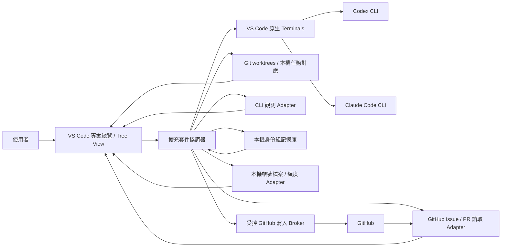

# 多代理人 CLI 協作平台實作計劃

狀態：計劃草案，可作為第一版實作與驗收依據

更新：2026-10-14
目標環境：macOS 與 Windows 的 VS Code Desktop、以 GitHub 為來源的專案、Codex CLI、Claude Code CLI 與 agy（內建 provider 範圍見 [Provider 登錄](PROVIDERS.md)）

## 1. 問題與產品邊界

使用者目前在 VS Code 手動開多個 terminal，自己命名、切換與拼裝各個 CLI coding agent。這讓同一專案的工作狀態、任務歸屬、實際使用的服務帳戶與用量難以集中判斷。使用者也需要替 agent 指定身份組、工作規則與任務，以 GitHub Issues／PRs 協作，並保證執行階段的 agent 資訊不會進入 GitHub 的 commit、PR、issue 等內容。

**產品目標：**在同一個 VS Code 視窗中，讓一個 GitHub 專案的多個 agent 各自運行於可直接輸入、可看見原始輸出的真實終端機；以 GitHub Issue 作任務入口、PR 作交付與 review 管道，同時提供專案總覽、角色與任務管理、同 provider 多帳號登入與 agent 指派、逐帳號可核實的額度／用量控制、依身份組共享的精選記憶，以及 GitHub 發布政策。

第一版必須同時支援 **macOS 與 Windows 本機 VS Code Desktop、本機 CLI**；兩平台的主要功能與驗收門檻相同。Windows 指原生 Windows 工作流程，不把 WSL 視為 Windows 支援的唯一實作。Linux、Remote SSH、Codespaces、Dev Containers、網頁版 VS Code 與其他代理服務列為後續相容性項目。Windows 的正式最低版本及 CPU 架構以 P0 實測和所選 CLI 官方支援範圍定案，並在發佈文件明列。

### 必要條件

| ID | 使用者可觀察的要求 | 驗收方式 |
| --- | --- | --- |
| R01 | 一個 GitHub 專案的所有 agent 在同一個 VS Code 視窗可找到、可切換，並有一個總覽畫面。 | 開啟同一 repo，建立 1 個 PM、3 個 worker，總覽列出四者與對應任務。 |
| R02 | 每個 agent 使用**真實、互動中的 CLI 終端機**。畫面顯示原始輸出，使用者可鍵入指令、回答 CLI 提示及中斷程序。 | 在兩種 CLI 各完成一次輸入、權限確認、`Ctrl+C`、結束及重啟；終端輸出和 CLI 原生輸出一致。 |
| R03 | 多個 agent 的終端機可在同一專案畫面中同時觀看。 | 以 VS Code 原生 terminal/editor 分割排列至少四個同時運行的 terminal，無須切換專案或視窗。 |
| R04 | 可定義身份組、PM/worker 等角色、服務、工作目錄、任務及系統／專案規則。 | 從模板建立兩個不同身份組，確認任務、規則與 CLI 啟動設定均綁定正確。 |
| R05 | 同身份組共享精選記憶，降低重複背景成本。 | 新 agent 只取得其 repo 與身份組授權的相關記憶；記憶開關 A/B 測試記錄總 token 與任務品質。 |
| R06 | 看得出服務、設定的帳戶身份、可核實的實際帳戶、各次用量及可取得的額度。 | 對每一帳號、每一數值標示來源、讀取時間與「實際／估算／未知」；切換帳戶後不沿用舊數值。 |
| R07 | 呈現可核實的專案進度與程式碼變動。 | 從 GitHub Issue／PR／review／CI、Git 狀態、worktree 與測試建立可點擊證據；不顯示無來源的進度百分比。 |
| R08 | 執行階段 agent 資訊不得進入 commit、push、PR、issue 或其留言。 | 對已知敏感值與結構欄位測試提交／發布阻擋；繞過路徑須在可驗證的隔離模式中被封閉。 |
| R09 | 第一版在 macOS 與 Windows 都能完成相同核心流程。 | R01–R08、R10–R13 的驗收情境分別在兩平台執行；任何一平台缺少必要能力時不得宣稱第一版完成。 |
| R10 | 以 GitHub Issues／PRs 對話與交付：只有 PM 定義 issue；coding agent 領取 issue、提交 PR；PM 持續 code review 至通過。 | 權限測試證明 worker 無法建立／改寫 issue 需求；一個 issue 經領取、PR、要求修改、再次提交、PM 通過的完整循環均可在 GitHub 查閱。 |
| R11 | Merge 決策可設定為「人工」或「PM」，預設人工。 | 人工模式中 PM 只能標記可合併，不能觸發 merge；PM 模式中只有指定 PM 可在最新 review 通過且必要檢查成功後執行 merge。 |
| R12 | 同一 provider 可同時登入多個帳號，使用者可替每個 agent 指定帳號。第一階段內建 provider 為 Claude Code、Codex CLI、agy；agy 在官方文件與實機驗證前只有終端啟動，帳號隔離、身份核實與額度一律標示未知。 | 兩個 Claude Code 帳號及兩個 Codex 帳號分別啟動同時運行的 agent；所選設定目錄、登入狀態、session 與本機資料不串用；實際帳號無法由服務核實時明確標示。 |
| R13 | 逐帳號查看可取得的配額與用量，並依設定控制工作分派。 | 額度視圖列出來源、時間窗、已用量／剩餘量或未知、重置時間；超過使用者設定門檻時警示、阻擋新任務或要求確認，不默默改用另一個帳號。 |

## 2. 核心使用流程

1. 使用者開啟 GitHub repo，擴充套件辨識 remote、branch、worktree、現有 Issues／PRs 與 CLI 可用性。
2. 使用者在擴充套件的帳號頁為 Codex、Claude Code 等 provider 建立多個登入設定，分別完成 CLI 登入並檢查實際帳號與可取得的額度；建立身份組時指定預設帳號，也可在個別 agent 上覆寫。
3. 使用者建立身份組，例如「規劃」、「實作」、「審查」；每組指定角色模板、所需服務、允許工作範圍、共享記憶與規則。
4. PM 根據需求建立 GitHub Issue，寫明目標、範圍與驗收條件；worker 只能領取現有 issue。領取前依指定帳號與額度政策判斷是否可啟動。領取成功後，每個 worker 取得獨立工作目錄，啟動具名稱的**VS Code 原生終端機**並運行 CLI，使用者可直接操作。
5. Worker 在自己的 worktree 完成任務，提交連結 issue 的 PR。總覽同步呈現 issue、PR、branch/worktree、review 與 CI，以及**逐 agent／逐帳號**來源可核實的用量和額度；點擊可聚焦 terminal、diff 或 GitHub 對話。
6. PM 在 PR review 提出問題或要求修改；worker 更新同一 PR，直到 PM 對最新版本通過 review。若 repo 的 GitHub 規則要求正式核准，還須取得有效的 GitHub `APPROVE`。
7. Merge 權限由專案設定：預設**人工**在 review 與必要檢查通過後 merge；若使用者設定為 **PM**，授權 PM 可在同樣條件下決定並執行 merge。Issue 在 merge 後更新／關閉。
8. 任務完成後，系統擷取**可審核的摘要**作為候選私人記憶；經規則或人類核可後存入該身份組記憶庫。建立下一個同組 agent 時只擷取相關片段。
9. GitHub Issue、PR、review、留言與 merge 等寫入都經角色權限與內容政策檢查；是否需要人工逐筆確認由動作權限設定決定。若執行環境無法隔離直接寫入路徑，畫面不得宣稱「保證不外洩」。

## 3. 架構選擇

### 3.1 真實終端機

首選 [VS Code Terminal API](https://code.visualstudio.com/api/references/vscode-api) 的 `window.createTerminal`，以 `cwd`、`env`、名稱及 `location` 建立各 agent 的真實 shell/PTY，並使用 VS Code 既有的 split terminal 或 terminal editor 配置。總覽視圖只管理入口與狀態，**不重畫或模擬 CLI 輸出**。啟動後記錄 terminal 與 session 的對應；使用者仍可直接在 terminal 打字。

Terminal API 對多格版面的可程式化控制、重啟後附著，以及完整輸出擷取有限制。狀態觀測優先使用服務公開的 session 檔案、事件、hooks 或 API；[shell integration](https://code.visualstudio.com/docs/terminal/shell-integration) 只能當額外訊號，不能當唯一依據。不可為了監控而以攔截鍵盤、偽造 terminal 文字或自行代打 CLI 取代原始體驗。

**P0 決策門檻：**驗證在目標 VS Code 版本同時排列四個可互動的原生 terminal。若 API 不能自動建立理想的 2×2，先提供「建立 terminal 分組 + 一次性的 VS Code 原生拖放／分割」操作。若連使用者可接受的同畫面排列都做不到，停止 R03 的實作承諾，提交可重現證據再決定是否改用 [node-pty](https://github.com/microsoft/node-pty) + [xterm.js](https://github.com/xtermjs/xterm.js) 的**真 PTY**方案；後者會改變終端 UI，須另外驗收，不得以假 dashboard 冒充 terminal。

**跨平台終端設計：**啟動 CLI 應以可執行檔與引數陣列為基礎，尊重使用者的 [VS Code terminal profile](https://code.visualstudio.com/docs/terminal/profiles)，不把 macOS 的 zsh 指令字串直接交給 Windows PowerShell。Windows 須分別驗證 PowerShell 和 Git Bash 設定、CLI 安裝路徑、空白與 Unicode 路徑、`Ctrl+C`、互動提示及 VS Code 重啟後的狀態。WSL 可作額外執行環境，但不能取代原生 Windows 終端驗收。

### 3.2 CLI Adapter 與資料可信度

每個 provider adapter 實作 `discover → launch(accountProfileId) → observe → stop/resume → account → usage/quota`。共同事件欄位至少有 `repoId`、`agentId`、`provider`、`accountProfileId`、`roleGroupId`、`taskId`、`terminalId`、`sessionId?`、`observedAt`、`source`、`confidence`。狀態分為「準備中、運行中、等待使用者、完成、失敗、未知」；只有具證據的事件才可進入總覽。

- **Codex：**CLI 仍在真 terminal 運行。評估官方 [Codex App Server](https://learn.chatgpt.com/docs/app-server) 的 thread、account、rate limit 資料與 CLI session 是否能可靠對應；無法對應就只呈現 session 可核實的資料。隔離執行設定時考慮 [`CODEX_HOME`](https://learn.chatgpt.com/docs/config-file/environment-variables)。
- **Claude Code：**CLI 仍在真 terminal 運行。評估官方 [status line](https://code.claude.com/docs/en/statusline)、[hooks](https://code.claude.com/docs/en/hooks) 與 session 產物，取得模型、用量、等待狀態等訊號。檢查 [`CLAUDE_CONFIG_DIR`](https://code.claude.com/docs/en/env-vars) 及 API key／訂閱切換的影響。
- **既有使用者 terminal：**只有在可辨識進程與 session 的情況下附著觀測；不確定其帳戶或用量時顯示「未知」。

每個用量欄位須有單位與範圍，例如「本次 session 的 input/output tokens」、「服務回報的 5 小時限制」、「本機估算費用」。訂閱方案、API 計費、快取 token 與週期額度不得混成一個「剩餘百分比」。帳戶識別先分「使用者設定的標籤」及「由服務確認的帳戶」；兩者不一致時顯示警示。密鑰僅存於 [VS Code SecretStorage](https://code.visualstudio.com/api/references/vscode-api) 或既有 CLI 認證環境，不寫入專案設定、log 或記憶。

#### 3.2.1 同 provider 多帳號與額度控制

帳號頁依 provider 列出多個 `AccountProfile`，例如「Claude 個人」、「Claude 工作」。每個檔案有本機 ID、使用者標籤、登入方式、隔離的 CLI 設定位置、已驗證的服務主體（若可取得）、方案（若可取得）、登入健康狀態，以及各額度時間窗。身份組只設定**預設帳號**；建立或編輯 agent 時可選另一帳號。選定後將 `accountProfileId` 固定在 session，並在 terminal 標題及總覽顯示標籤；切換帳號須啟動新 session，不暗中改變運行中的 CLI。

這裡的 Codex／Claude 登入與第 3.6 節的 GitHub 發布身份是兩套獨立設定；不能因為 agent 使用某個 CLI 帳號，就把該帳號名稱、email 或額度寫入 Issue、PR、review 或 commit。

- **Claude Code：**官方[多帳號登入說明](https://code.claude.com/docs/en/authentication)支援每個帳號使用獨立 `CLAUDE_CONFIG_DIR`；擴充套件為每個檔案建立 repo 外的專用資料夾，在對應 terminal 啟動時設定該路徑並由使用者完成登入。官方文件指出不使用 API key 的兩個 Claude Console 登入可能不受此資料夾隔離，這種登入組合須在 P0 實測，無法隔離就標為不支援，不能假裝是兩個帳號。[`ANTHROPIC_API_KEY` 會覆蓋訂閱登入](https://code.claude.com/docs/en/env-vars)，啟動前須檢查繼承環境與設定，發現意外覆蓋就阻擋受管啟動。
- **Codex：**以官方 [`CODEX_HOME`](https://learn.chatgpt.com/docs/config-file/environment-variables) 為每個帳號隔離 CLI 設定、session 與可分離的認證資料。官方[認證文件](https://learn.chatgpt.com/docs/auth)說明檔案與作業系統憑證庫等儲存方式；P0 須驗證所選方式在 macOS／Windows 對兩個同時登入的帳號是否真正隔離。不能讀取或複製使用者的登入 token 來完成分配。
- **驗證：**建立檔案後由 CLI 走原生登入流程。Claude 優先用官方 [`claude auth status` JSON](https://code.claude.com/docs/en/cli-reference) 驗證登入方式及設定目錄；Codex 評估 [App Server `account/read`](https://learn.chatgpt.com/docs/app-server) 是否能對應到同一 `CODEX_HOME` 的真 terminal。將「檔案標籤」與「實際服務主體」分別顯示；服務未公開主體時顯示未知，並要求使用者確認檔案標籤。若可核實主體與設定不符或兩個檔案其實是同一帳號，標記異常；受管模式在設定目錄或登入狀態未核實時不得開始新任務。非受管 terminal 只顯示可證實的資料。

額度頁以**實際帳號**為單位顯示每個可取得的 quota bucket／時間窗：已用百分比、可計算的剩餘量、重置時間、來源與最後更新時間；另列該帳號在本套件管理的 session token／估算成本。兩個檔案若指向同一實際帳號，其服務額度不能算兩份。Claude [status line 的 `rate_limits`](https://code.claude.com/docs/en/statusline) 可提供部分訂閱帳號的 5 小時、7 天用量與重置時間，欄位可能缺席；Codex [App Server 的 account/rateLimits/read](https://learn.chatgpt.com/docs/app-server) 可提供帳號額度，但須驗證與真 terminal 所用登入的對應。服務未提供的配額、訂閱或帳單資訊顯示「未知」，不可由本機 token 推算成官方剩餘額度。

使用者可對每個帳號設定警示門檻、停止分派新任務的門檻、同時運行 agent 上限，以及額度未知時「要求確認」或「禁止新任務」。策略只使用有來源且未過期的資料做硬性**分派門檻**；估算資料只能提示。達門檻後可暫停待領取 issue 或新 agent 啟動，使用者可明確覆寫；不自動將現有 agent 換到另一帳號。已有真 terminal 仍可由使用者操作，服務端額度也可能在兩次更新間變動，因此此策略不能宣稱精確阻止所有超額請求。

### 3.3 專案、任務與角色

一個專案以 repo canonical path + GitHub remote ID 識別；**GitHub Issue 是任務需求的權威來源**，本機任務記錄只保存 issue 與 agent session、worktree、私有狀態的對應。一個 issue 可有多名 agent 協助，但同一時刻須有明確的主要領取者；一個 agent 有明確的當前 issue。預設每個 worker 使用 [Git worktree](https://git-scm.com/docs/git-worktree.html) 隔離檔案變更；PM 可以只讀取各 worktree 的 diff、測試與任務摘要。Windows 路徑處理須覆蓋磁碟代號、大小寫、空白、Unicode 與 worktree `.git` 指向檔；不可用字串拼接假設 POSIX 路徑。若使用者刻意共用工作目錄，介面須提示衝突，且不能把檔案修改自動歸因給某個 agent。

身份組設定包括 `id/name`、`role`、`provider/CLI`、`defaultAccountProfileId`、`allowed repositories/paths`、`tool permissions`、`task templates`、`memory scope`、`instruction set`；個別 agent 的 `accountProfileId` 可覆寫身份組預設帳號。有效規則順序：**平台不可覆寫規則 → 使用者全域規則 → 專案規則 → 身份組規則 → 任務規則**。衝突時較低層級不能放寬較高層級限制。啟動時產生可檢視的「有效設定」，記錄來源與版本，避免看不出 agent 收到哪一套指示。

角色提示只負責工作方式與輸出期望，權限仍須由系統層限制。Codex 的 [custom agents](https://learn.chatgpt.com/docs/agent-configuration/subagents) 與 Claude Code 的 [subagents](https://code.claude.com/docs/en/sub-agents) 可作為角色映射參考，但本產品的「一個 agent = 一個可操作的真 terminal」是第一版主要模型；CLI 內部產生的 subagent 應另外標示為子程序，不能算成獨立可操作 terminal。

使用者設定的「系統指令」是產品層級的高優先規則，不保證能寫入供應商模型真正的 system message；Codex 與 Claude CLI 支援的指令入口及優先序須分別驗證。凡 CLI 不支援的強制規則，應由工作環境或 broker 執行，不能因為提示詞寫了「必須」就宣稱已強制。

### 3.4 依身份組共享記憶

**主鍵為 `(repoId, roleGroupId, privacyDomain)`**。建立帳號檔案時指定本機資料隱私域，預設每個帳號各自一域；使用者可把同一信任邊界內的帳號歸為同一域，使同身份組的 agent 跨這些帳號共享精選記憶。若兩個登入帳號屬不同組織／資料邊界，預設維持隔離。跨專案或跨身份組分享也須明確設定。記憶可含架構決策、已證實的專案慣例、任務交接、待查風險；不得存放密鑰、帳戶識別碼、原始對話、完整 terminal transcript 或未審核的推測。

每條記憶至少記錄 `content`、`source task/commit/file`、`author agent`、`created/verifiedAt`、`scope`、`TTL/stale rule`、`sensitivity`、`version`。來源檔案改變後標為待複核。寫入流程：CLI／任務產出候選摘要 → 去重與敏感值掃描 → 必要時人類確認 → 本機儲存。讀取流程：依 repo、身份組與任務檢索 → 只取少數相關且仍有效片段 → 限定注入 token 預算 → 在有效設定中列明來源。可刪除、停用、重建與匯出；預設不與 Git 同步。

第一版先用本機結構化儲存與全文索引建立基線，避免過早引入向量服務。若檢索品質不足，再評估 [Mem0](https://github.com/mem0ai/mem0) 作為可替換的本機記憶 adapter。Mem0 專案公開的節省 token 數字涉及其特定評測／服務設定，**不能直接當作本產品效果保證**。測量時比較記憶開／關的**總** input、output、cache read/write、記憶建立與檢索成本，以及任務成功率、錯誤率、完成時間；不同 provider 無法讀到的項目標為未知。共享記憶可能增加 token，因此只有實測總成本下降且品質不退步時才宣稱「節省」。[Prompt caching 文件](https://developers.openai.com/api/docs/guides/prompt-caching) 提供成本分類參考，但 CLI 訂閱的快取細節必須另行驗證。

P0 須在 macOS 與 Windows 逐一驗證兩個 CLI 如何在**不將私人記憶寫入 repo**、不失去 terminal 互動性的前提下接收啟動背景資料。若某個 CLI 只能透過會被提交的 repo 檔案取得記憶，就暫不對該 CLI 啟用自動注入，改由使用者從本機記憶面板選取並手動送入終端；不得偷偷產生 `AGENTS.md`、`CLAUDE.md` 或其他可被 Git 追蹤的私人檔案。

### 3.5 GitHub 資訊保護與權限

「agent 資訊」在此指執行階段身份／帳戶對應、token 或額度、提示詞與系統指令、私有記憶、session ID、terminal transcript、內部任務協調紀錄及任何憑證。**Issue 的需求、驗收條件、可公開的工作討論、PR 的變更說明及 code review 意見可以寫入 GitHub**，但不得包含前述私人資訊。一般公開產品文件描述「支援 agent」不屬於私人資料。此定義應是可編輯的資料分類政策，但預設不得放寬敏感欄位。

政策執行分三層：

1. **生成約束：**在有效規則中要求 agent 不把上述資料放進檔案、commit 訊息、PR、issue 或留言；在角色模板中提供安全的公開內容格式。
2. **本機阻擋：**檢查 staged diff、commit message、GitHub 發布表單與 broker payload，對已知秘密、session ID、內部路徑和結構欄位採 fail-closed；提供人類可審核的刪改建議。[Git hooks](https://git-scm.com/docs/githooks) 與 provider [hooks](https://code.claude.com/docs/en/hooks) 只能增加防護，不能當最終隔離邊界，因為 hook 可被繞過或 coverage 不完整。
3. **權限邊界：**需有「受管模式」：agent 的執行環境不直接取得 GitHub 寫入憑證，不能直接向 GitHub 寫入；受控 GitHub broker 持有最小權限憑證，依角色與第 3.6 節的 merge 模式檢查 commit/push/PR/issue/review/comment/merge 的操作與內容。PM 建 issue、worker 領取／開 PR、PM review 等已授權動作可由 broker 執行，無須每次人工確認；merge 則遵守所選模式。若要強制保證 commit 訊息也不含敏感內容，還須證明 agent 不能繞過 broker 直接執行 `git commit`；單靠 PATH 中的 wrapper 或 git hook 不足以證明。實作前驗證 CLI 認證仍可正常運作，且 agent 無法讀取使用者原有 Git credential helper、`gh` token 或繞過網路限制。[GitHub App 權限](https://docs.github.com/en/apps/creating-github-apps/registering-a-github-app/choosing-permissions-for-a-github-app) 應按操作分配最小範圍。

**限制：**任意 shell 若可讀取使用者 GitHub 憑證或直接連網，單靠 prompt、擴充套件按鈕與 git hook 無法保證 R08。P0 必須分別在 macOS 與 Windows 做憑證及網路隔離實證。依 [Claude Code 官方設定文件](https://code.claude.com/docs/en/setup)，其原生 Windows 模式目前不提供內建 sandbox；因此 Windows 的強制政策不能依賴 Claude 的內建 sandbox，須由產品自己的隔離環境與 broker 驗證。WSL2 可列為強制隔離的候選，但第一版仍須提供原生 Windows CLI 工作流程。任一平台未通過時，該平台只能標示「建議與檢查模式」，不能宣稱強制防止外洩，也不能通過 R08 的完整驗收。語意改寫後的私人資訊也可能逃過字串掃描，因此外部發布仍需人類審核。

### 3.6 GitHub Issue、PR 與 review 協作協定

**權威資料與連結：**PM 透過 broker 建立或修改 GitHub Issue 的標題、需求、範圍與驗收條件；worker 只能領取現有 issue、更新允許的狀態或留言，不能自行創建 issue 或改寫需求。領取後在本機保存 `repo + issue number → agent session + worktree + branch` 對應，公開 PR 只連結 issue 編號與可公開的變更內容。GitHub Issue／PR／review／CI 是可分享的工作紀錄；本機資料庫承載終端、帳戶、用量與私人記憶。[GitHub Issues](https://docs.github.com/en/issues/tracking-your-work-with-issues/using-issues) 與 [PR review](https://docs.github.com/en/pull-requests/how-tos/review-pull-requests/reviewing-proposed-changes-in-a-pull-request) 是此流程的直接依據。

| 動作 | PM | Coding agent | 人工 |
| --- | --- | --- | --- |
| 建立／改寫 issue 需求與驗收條件 | 允許 | 禁止 | 可管理設定與例外 |
| 領取／釋放 issue、更新工作狀態 | 管理與重派 | 允許領取可用 issue | 可管理 |
| 建立／更新連結 issue 的 PR、回覆 review | 不代替 worker 建立 PR | 允許 | 可管理 |
| 提出 PR review、要求修改、確認通過 | 負責 | 不得審核自己的 PR | 可審核 |
| Merge PR | 僅 PM merge 模式允許 | 禁止 | 人工模式負責；保留 repo 擁有者權限 |

領取操作由 broker 對 repo + issue 做單一寫入者協調，先重讀 Issue 狀態再寫入，遇到已被領取或遠端變更就拒絕並重試同步；若多台機器共用 repo，P0 必須驗證跨客戶端避免雙重領取的機制，否則標示衝突並停下分派。可在 GitHub 以中性的狀態 label 顯示「已領取」，**具體哪個本機 agent 領取只留本機**。GitHub 會顯示發文的帳戶或 App 身份，這是平台固有可見性；須使用使用者可接受的中性發布身份，並檢查 commit author/committer 名稱與 email，不在標題、正文、留言、commit 或 PR 填入本機 agent ID／CLI 帳戶對應。

**狀態轉移：**`Ready issue → Claimed → In progress → PR open → Review pending → Changes requested ↔ Worker updates PR → Review pending → PM passed → Ready to merge → Merged / issue closed`。`Blocked` 可從執行中進入，由 PM 重排或補充需求後再回到可領取狀態。每次 review 結論以 GitHub 的 `REQUEST_CHANGES`、`COMMENT`、`APPROVE` 與最新 PR head commit 為證據；PR 有新 commit 後，舊的通過結論須重新評估，不能沿用舊 SHA 的通過狀態。CI 失敗、未解決對話或合併衝突時不得進入 `Ready to merge`。[GitHub review API](https://docs.github.com/en/rest/pulls/reviews) 與 [受保護分支規則](https://docs.github.com/en/repositories/configuring-branches-and-merges-in-your-repository/managing-protected-branches/about-protected-branches) 可提供正式 review 與檢查門檻。

**GitHub 身份限制：**[PR 作者不能核准自己的 PR](https://docs.github.com/en/pull-requests/how-tos/review-pull-requests/approving-a-pull-request-with-required-reviews)。如果所有角色共用一個 GitHub App／帳戶，PM 可留言但其 `APPROVE` 可能不能成為有效的正式審核。P0 必須驗證 worker 發 PR、PM 審核使用不同且具適當權限的 GitHub 主體；若無法配置，不能宣稱已達成 GitHub 正式 reviewer passed，也不能啟用以此為條件的 PM merge。GitHub 平台上的 actor 名稱不可完全隱藏，產品須清楚展示發布身份，而不把私人 CLI 帳戶或 session 身份寫入 GitHub。

**Merge 設定：**`mergeAuthority` 可設為 `human` 或 `pm`，預設 `human`。人工模式中 PM 只能完成 review 並標記可合併，broker 不提供 PM merge 權杖；人工在 GitHub 或擴充套件確認合併。PM 模式中只有被指定的 PM 可明確決定並觸發 broker merge，worker 沒有 merge 權限；CI 轉綠不會自行觸發 merge。兩模式都需最新 PR head 已通過 PM review、必要 CI 成功、對話已解決、無合併衝突，且符合 repo 的 branch protection／ruleset；merge 前再次讀取最新狀態。設定變更應記錄本機審計事件。GitHub 管理員在平台外可能另有權限，產品設定只能約束受管流程；repo 應配置 required reviews、status checks、限制旁路等[分支保護](https://docs.github.com/en/repositories/configuring-branches-and-merges-in-your-repository/managing-protected-branches/about-protected-branches)。

## 4. 現有開源專案與採用決定

下表是截至 2026-10-14 查閱的設計與授權基線；正式引入程式碼前重新核對所用 commit 的授權與相依套件。開源專案既有 UI／parser 可借鏡，但不能假設它們已滿足本產品的真 terminal、身份組、帳戶可信度與 GitHub 政策要求。

| 專案／來源 | 可借用內容 | 採用方式與界線 |
| --- | --- | --- |
| [VS Code Extension API](https://code.visualstudio.com/api/references/vscode-api)、[Agent Sessions](https://code.visualstudio.com/docs/agents/concepts/sessions) | 原生 terminal、Tree View、SecretStorage、現有 agent session 體驗。 | **核心平台 API**；先做原生 terminal spike，避免重造編輯器與終端。Agent Sessions 可作相容入口，不能替代自有多 terminal 畫面。 |
| [Git worktree](https://git-scm.com/docs/git-worktree.html) | 同 repo 多工作目錄、branch 隔離。 | **直接採用**，預設每個 worker 一個 worktree，保留使用者直接操作 Git 的能力。 |
| [Agent Flow](https://github.com/patoles/agent-flow)（[Apache-2.0](https://github.com/patoles/agent-flow/blob/main/LICENSE)） | Codex/Claude 事件與協作可視化的設計參考。 | **參考 adapter 與事件模型**；僅在資料格式及授權核對後複用局部實作，不整套嵌入 UI。 |
| [Claude Code Usage](https://github.com/ClaudeCodeUsage/ClaudeCodeUsage)（[MIT](https://github.com/ClaudeCodeUsage/ClaudeCodeUsage/blob/main/LICENSE)） | Claude Code 與 Codex 用量、配額呈現方式。 | **參考資料來源與計算**；驗證每個數值的來源、版本及估算條件後才移植。 |
| [agent-dashboard](https://github.com/bjornjee/agent-dashboard)（[MIT](https://github.com/bjornjee/agent-dashboard/blob/main/LICENSE)） | 多 session 狀態總覽、terminal 導航。 | **UX 參考**；本產品仍使用 VS Code 原生可互動終端。 |
| [Mem0](https://github.com/mem0ai/mem0)（[Apache-2.0](https://github.com/mem0ai/mem0/blob/main/LICENSE)） | 記憶抽取、檢索與更新策略。 | **P3 可替換 adapter 候選**；先完成本機基線及 A/B 測試，再決定是否依賴。 |
| [node-pty](https://github.com/microsoft/node-pty)、[xterm.js](https://github.com/xtermjs/xterm.js)（MIT） | 真 PTY 與終端模擬器。 | **僅為 P0 失敗後的技術備案**；不以只顯示假的輸出卡片替代 terminal。 |
| [Claude Command Center](https://github.com/amirfish1/claude-command-center)（目前版本為 FSL-1.1-MIT；見 [授權說明](https://github.com/amirfish1/claude-command-center#license)） | 多 agent 工作狀態與 terminal 導航的產品參考。 | **只研究產品行為，不複製目前版本程式碼**；授權不能先視為 MIT/Apache 類許可。 |

論文可提供設計假說：[MetaGPT](https://arxiv.org/abs/2308.00352) 與 [ChatDev](https://arxiv.org/abs/2307.07924) 描述角色化工作流程，[SEMAP](https://arxiv.org/abs/2510.12120) 強調明確的行為契約與交接，[MemGPT](https://arxiv.org/abs/2310.08560) 可供階層式記憶參考。另有[軟體工程 agent 框架實證研究](https://arxiv.org/abs/2511.00872)指出協作可能增加修正步驟與 token 開銷。這些研究不是本產品可節省 token 或提升品質的證據，需用第 7 節的實測驗收。

## 5. 資料模型與儲存

| 實體 | 必要欄位 | 儲存位置 |
| --- | --- | --- |
| Project | `repoId`、remote、root、branch、worktrees、policyVersion | VS Code 擴充套件本機 storage；公開設定可選擇置於 repo。 |
| AccountProfile | `id`、provider、使用者標籤、CLI 設定目錄、登入方式、可核實主體、privacyDomain、登入健康狀態 | 本機私人設定；憑證由 CLI／OS 的認證位置管理並限制檔案權限，不進 repo。 |
| IdentityGroup | `id`、名稱、角色、provider、預設 `accountProfileId`、規則版本、memory scope | 本機私人設定；可匯出已遮罩模板。 |
| AgentSession | `id`、group、issue、provider、固定 `accountProfileId`、terminal、worktree、開始／結束時間、狀態、來源 | 本機私人資料庫；不得放入 repo。 |
| GitHubIssueLink | `repoId`、issue number、領取狀態、主要 agent session、worktree、branch、最後同步時間 | Issue 需求以 GitHub 為準；session 與 agent 對應僅存本機。 |
| PullRequestLink | issue number、PR number、head SHA、review/CI 狀態、最後同步時間 | PR 與 review 以 GitHub 為準；本機保存導覽與快取。 |
| MergePolicy | `repoId`、`mergeAuthority`（`human` 或 `pm`）、必要 review/CI 條件、版本 | 本機私人設定；repo branch protection／ruleset 同步檢查。 |
| UsageSample | provider、accountProfileId、可核實主體、模型、session、計量範圍、數值、單位、來源、可信度、時間 | 本機資料庫；敏感欄位不進 log。 |
| QuotaSample | provider、可核實主體、bucket、時間窗、已用／可得剩餘量、重置時間、來源、讀取時間、有效期限 | 本機資料庫；同一實際帳號不可重複計算。 |
| AccountControlPolicy | accountProfileId、警示／停止分派門檻、並行上限、未知額度處理、版本 | 本機私人設定；只控制受管新任務分派。 |
| MemoryItem | scope、內容、來源、驗證時間、到期規則、敏感級別 | 本機私人記憶庫。 |
| PublishRequest | 操作、角色、目標 repo/issue/PR、內容摘要、掃描結果、所需授權／確認、結果 | 本機審計紀錄，依保留政策刪除。 |

資料庫需有 schema migration、原子寫入與刪除入口。預設任何含 `AccountProfile`、`AgentSession`、`UsageSample`、`QuotaSample`、`MemoryItem` 的檔案都在 repo 外；若使用者指定 repo 內路徑，系統應拒絕。設定頁提供匯出與清除選項；記憶與任務資料需分開管理。

## 6. 階段、交付物與停止條件

以下估算以一名熟悉 VS Code Extension、TypeScript 與 CLI 整合的工程師，且可使用 macOS 與 Windows 測試環境為基準；為排程假設，不是承諾日期。P0 的結果可能改變後續方案。

| 階段 | 估算 | 必須交付 | 通過條件／停止條件 |
| --- | --- | --- | --- |
| **P0 可行性** | 3–4 週 | macOS 與 Windows 各一個小型 VS Code extension spike；Codex/Claude 真 terminal；四格同畫面、私人規則／記憶注入、同 provider 雙帳號登入／並行／實際身份與額度來源、GitHub 直接寫入隔離實驗；GitHub Issue 領取衝突、worker PR 與 PM 正式 review 的身份驗證；Windows 版本與架構支援矩陣；結果與錄影／log。 | R02、R03 在兩平台可重現；R05 有安全注入路徑或明確的手動方案；R06/R12/R13 列明各帳號可核實欄位及隔離證據；R08 受管模式與 R10/R11 所需 GitHub 身份及權限可行，否則記錄阻礙並重新決策。 |
| **P1 專案與 terminal MVP** | 3–4 週 | 專案總覽、帳號檔案與 agent 帳號指派、agent 清單、建立／命名／重開／停止 terminal、worktree 建立與導覽、狀態基礎模型、macOS/Windows shell 與路徑適配。 | 兩平台各有四 agent 同 repo 同畫面運行，至少兩個同 provider agent 使用不同且已確認登入與隔離設定的帳號檔案；手動輸入、提示確認、`Ctrl+C`、CLI 崩潰重啟；重開 VS Code 後不誤報運行或串用帳號。 |
| **P2 身份組與協作** | 3–4 週 | 身份組編輯、有效規則預覽、PM/worker 模板、Issue 建立／領取、PR 連結與 review 循環、同 repo 多 worktree 衝突偵測。 | 兩平台設定可追溯；worker 不能定義 issue；issue、PR、review 與本機 session 對應正確；低優先規則不能覆蓋平台規則。 |
| **P3 觀測、用量與記憶** | 4–5 週 | 兩平台 provider adapters、逐帳號額度與時間窗、來源／可信度標示、警示／停止新任務／並行上限、帳戶切換提示、本機記憶庫、檢索與 A/B 測量。 | 兩平台無來源數據顯示未知；不同帳號額度不混算；門檻對新任務生效；記憶不跨錯誤身份組／隱私域；實測報告含總 token 與品質。 |
| **P4 GitHub 發布控制** | 4–6 週 | 分類掃描、issue／commit／PR／review 模板、依角色最小權限 broker、人工／PM merge 設定、macOS/Windows 各自的隔離模式與審計紀錄。 | 兩平台的受管流程阻擋已知執行階段 agent 資訊；worker 無法建立 issue、review 自己 PR 或 merge；兩種 merge 模式各自通過；直接 `git commit`／`git push`／`gh` 旁路在強制模式中失敗。 |
| **P5 發佈準備** | 2–3 週 | 兩平台安裝與使用說明、設定遷移、擴充套件打包、例外處理、VS Code 版本與 Windows 支援矩陣驗證。 | macOS、Windows 都通過第 7 節端對端情境；授權與第三方聲明齊全；兩平台安裝後均可跑通首個專案。 |

**依賴順序：**P0 → P1 → P2；P3 依賴 P1/P2 的 session 與身份組識別；P4 的內容掃描可與 P3 部分並行，但強制保證依賴 P0 的隔離結果；P5 在前述通過後開始。若 P0 原生 terminal 或 GitHub 隔離不通過，先修改需求或架構決策紀錄，不用 UI 文案掩蓋限制。

## 7. 驗收、測量與失敗情境

### 端對端驗收

以下每一項都須分別在 macOS 與 Windows 的正式支援版本通過，不能用單一平台的結果推定另一平台合格。

1. 分別在 macOS 與 Windows 的乾淨 GitHub 測試 repo 設定 PM、兩個 Codex worker、一個 Claude worker；為同一 provider 的兩個 worker 指定不同帳號，打開四個原生 terminal，輸入不同指令，分別完成互動提示與中斷。
2. PM 建立含驗收條件的 Issue；兩個 worker 各領不同 issue 與 worktree，建立連結 issue 的 PR。PM 可看到 issue、PR、branch、diff、測試結果；總覽每個狀態都有對應 GitHub／本機來源或顯示未知。
3. 設定兩個身份組，讓同組第二個 agent 取得精選的有效記憶，另一組不得取得；修改來源檔案後舊記憶標為待複核。
4. 用同一任務集做記憶開／關對照，記錄 input/output/cache/記憶處理的可得成本、完成時間與成功率。無法取得供應商實際 tokens 時標示估算，不作節省結論。
5. Worker 送 PR 後，PM 在 GitHub 提出 `REQUEST_CHANGES`，worker 更新同一 PR，PM 對最新 SHA review 通過。確認舊 SHA approval、失敗 CI、未解決對話與合併衝突不會進入可合併狀態；測試第二個 worker 同時領取同一 issue 時被阻擋或提示衝突。
6. 在 `human` 模式由人工 merge，PM 不可觸發；在 `pm` 模式由指定 PM 決定並 merge，worker 不可觸發。兩模式都驗證 GitHub 正式 review、必要 CI 與 branch protection；merge 後 issue 正確關閉或更新。
7. 注入已知 session ID、帳戶代號、系統指令片段到 staged diff、commit message、PR、issue、review、comment；受管模式全部阻擋或要求移除。確認直接 `git commit`、`git push`、`gh`、credential helper 及直接 HTTP 旁路無法繞過相應政策。
8. 兩平台分別同時登入兩個 Claude Code 與兩個 Codex 帳號，為不同 agent 指定帳號，核對真 terminal 的實際登入與額度；測試重複指向同一帳號、API key 覆蓋訂閱、登入失效、配額讀取失敗、門檻觸發與額度未知處理，不得混算或靜默換帳號。
9. 兩平台分別測試離線、CLI 非預期結束、VS Code 重啟、worktree 已被外部刪除，確認狀態正確降級並提供可恢復操作。Windows 另測 PowerShell、Git Bash、含空白及 Unicode 的工作路徑。

### 最低品質門檻

- 所有顯示的數據須附來源與讀取時間；沒有可核實資料就顯示未知。
- 帳號檔案標籤、實際登入主體與帳號額度分開顯示；不同帳號的 session 和數據不可互串，過期配額不可當作即時數值。
- 任何密鑰、原始 transcript、私有記憶和執行階段帳戶資料不得寫入 repo、擴充套件診斷 log 或 GitHub 測試內容。
- 若記憶 A/B 沒有證明總 token 下降，不顯示「省 tokens」產品宣稱；仍可保留有助品質的記憶功能。
- VS Code 擴充套件測試使用官方 [extension test runner](https://code.visualstudio.com/api/working-with-extensions/testing-extension)；涉及 terminal 操作、GitHub 權限與使用者審核的關鍵流程須另做真機端對端驗證。

## 8. 主要風險與決策紀錄

| 風險 | 觀察方式 | 對策／決策點 |
| --- | --- | --- |
| VS Code Terminal API 無法完全控制四格排列或讀取所有輸出。 | P0 在 macOS、Windows 與目標 VS Code 版本實測。 | 保持原生 terminal，可由使用者一次性分割；觀測改用 provider 事件。任一平台仍不滿足 R03 才評估真 PTY 方案。 |
| CLI 帳戶與訂閱用量沒有穩定公開 API，或與 terminal session 無法對應。 | P0 對照 CLI 原生顯示與 adapter 資料。 | 欄位級可信度；不推斷未確認帳戶，不合併不同計費範圍。 |
| 同 provider 多帳號的 OS 憑證儲存、CLI 設定或繼承環境互相覆蓋。 | P0 在 macOS/Windows 用兩帳號並行登入、登出、重啟、API key 覆蓋案例驗證。 | 分隔設定目錄與認證方式；實際身份不符時拒絕受管啟動；官方不支援隔離的登入組合明確標為不支援。 |
| 額度資料缺失、延遲或只涵蓋部分訂閱／計費模式。 | P3 比對 provider 原生顯示與各 account quota bucket。 | 顯示未知／過期、只對可核實的新任務做分派門檻；不承諾精確阻止既有 session 的超額使用。 |
| VS Code 擴充套件無法單獨隔離任意 shell 的 GitHub 憑證與網路。 | P0 在 macOS/Windows 各用 `git`、`gh`、credential helper 與直接 HTTP 測旁路。 | 受管模式可能需要平台專屬隔離環境／本機 companion；任一平台未通過前，第一版不能宣稱 R08 強制保證。 |
| Windows PowerShell、Git Bash、CLI 認證與路徑規則不同，且 Claude 原生 Windows 無內建 sandbox。 | P0 逐一驗證原生 Windows 終端、登入、worktree 與隔離。 | 以平台 adapter 處理；若需要 WSL2 隔離，仍須保留原生 Windows 核心流程，並驗證完整 R08。 |
| 共享記憶過期、跨組洩漏或比重複上下文更耗 tokens。 | P3 權限測試、來源失效測試、A/B 成本與品質測量。 | 預設局部共享、驗證來源與 TTL、少量擷取、可停用／刪除。 |
| PM 與 worker 共用 GitHub actor，使 PM 的 review 無法成為有效核准；或多個客戶端同時領取同一 issue。 | P0 用真實測試 repo 驗證正式 review、雙重領取與跨客戶端同步。 | 分離發布主體；broker 採單一寫入者與同步檢查；無法保證時不得標記 reviewer passed 或啟用 PM merge。 |
| OSS 授權或 upstream 格式變更。 | 引入前記錄版本與 LICENSE，維護相容性測試。 | 優先官方 API，第三方以可替換 adapter 封裝；source-available 專案只參考行為。 |

### 目前決策

- **D01：**第一版同時支援 macOS 與 Windows 的 VS Code Desktop 擴充套件，核心工作流使用原生可互動 terminal。
- **D02：**一個 worker 預設一個 Git worktree；專案進度依可點擊證據呈現。
- **D03：**身份組記憶預設本機、同 repo 同組共享，採精選與來源驗證；是否省 tokens 要實測。
- **D04：**用量、額度與帳戶逐欄標示實際／估算／未知，不能把使用者標籤當作已驗證帳戶。
- **D05：**GitHub 寫入須經角色權限與內容政策檢查；已授權的 issue／PR／review 動作可由 agent 執行，merge 依專案設定；「強制防外洩」只在 macOS 與 Windows 都證明隔離可行的受管模式提供。
- **D06：**開源專案先採用官方 API 與 Git worktree；第三方邏輯經授權和資料可靠性審查後才納入相依。
- **D07：**GitHub Issue 是任務需求權威來源，worker 只領取既有 issue 並以 PR 交付；PM 在 GitHub review 到最新版本通過。
- **D08：**Merge 權限由專案設定為 `human` 或 `pm`，預設人工；PM 模式仍須符合正式 review、CI 和 GitHub 分支規則。
- **D09：**同 provider 支援多個本機帳號檔案與逐 agent 指派；帳號與 session 需隔離，逐帳號顯示可取得的額度並控制新任務分派。

## 9. 下一步

開始 P0 前備妥可執行 VS Code、Codex CLI 與 Claude Code CLI 的 macOS 和 Windows 測試環境、各 provider 至少兩個可測帳號，以及可測試 Issue、PR、正式 review、branch protection 的 GitHub 測試 repo；記錄各自 OS/CPU/VS Code/CLI 版本與 GitHub 發布主體，並確定 Windows 正式支援矩陣。P0 應在兩平台各產出可操作的四 terminal prototype、雙帳號隔離與額度來源報告、GitHub 角色權限與旁路測試報告。通過之後才把本計劃細分為程式任務與使用者介面稿。
