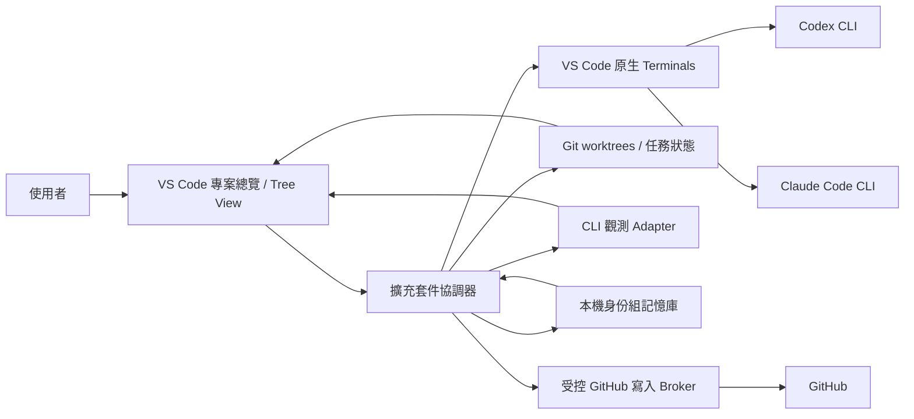

# 多代理人 CLI 協作平台實作計劃

狀態：計劃草案，可作為第一版實作與驗收依據

更新：2026-10-14
目標環境：macOS 與 Windows 的 VS Code Desktop、以 GitHub 為來源的專案、Codex CLI 與 Claude Code CLI

## 1. 問題與產品邊界

使用者目前在 VS Code 手動開多個 terminal，自己命名、切換與拼裝各個 CLI coding agent。這讓同一專案的工作狀態、任務歸屬、實際使用的服務帳戶與用量難以集中判斷。使用者也需要替 agent 指定身份組、工作規則與任務，並保證執行階段的 agent 資訊不會進入 GitHub 的 commit、PR、issue 等內容。

**產品目標：**在同一個 VS Code 視窗中，讓一個 GitHub 專案的多個 agent 各自運行於可直接輸入、可看見原始輸出的真實終端機，同時提供專案總覽、角色與任務管理、可追溯的帳戶及用量、依身份組共享的精選記憶，以及 GitHub 發布政策。

第一版必須同時支援 **macOS 與 Windows 本機 VS Code Desktop、本機 CLI**；兩平台的主要功能與驗收門檻相同。Windows 指原生 Windows 工作流程，不把 WSL 視為 Windows 支援的唯一實作。Linux、Remote SSH、Codespaces、Dev Containers、網頁版 VS Code 與其他代理服務列為後續相容性項目。Windows 的正式最低版本及 CPU 架構以 P0 實測和所選 CLI 官方支援範圍定案，並在發佈文件明列。

### 必要條件

| ID | 使用者可觀察的要求 | 驗收方式 |
| --- | --- | --- |
| R01 | 一個 GitHub 專案的所有 agent 在同一個 VS Code 視窗可找到、可切換，並有一個總覽畫面。 | 開啟同一 repo，建立 1 個 PM、3 個 worker，總覽列出四者與對應任務。 |
| R02 | 每個 agent 使用**真實、互動中的 CLI 終端機**。畫面顯示原始輸出，使用者可鍵入指令、回答 CLI 提示及中斷程序。 | 在兩種 CLI 各完成一次輸入、權限確認、`Ctrl+C`、結束及重啟；終端輸出和 CLI 原生輸出一致。 |
| R03 | 多個 agent 的終端機可在同一專案畫面中同時觀看。 | 以 VS Code 原生 terminal/editor 分割排列至少四個同時運行的 terminal，無須切換專案或視窗。 |
| R04 | 可定義身份組、PM/worker 等角色、服務、工作目錄、任務及系統／專案規則。 | 從模板建立兩個不同身份組，確認任務、規則與 CLI 啟動設定均綁定正確。 |
| R05 | 同身份組共享精選記憶，降低重複背景成本。 | 新 agent 只取得其 repo 與身份組授權的相關記憶；記憶開關 A/B 測試記錄總 token 與任務品質。 |
| R06 | 看得出服務、設定的帳戶身份、可核實的實際帳戶、各次用量及可取得的額度。 | 對每一數值標示來源、讀取時間與「實際／估算／未知」；切換帳戶後不沿用舊數值。 |
| R07 | 呈現可核實的專案進度與程式碼變動。 | 從 Git 狀態、worktree、任務、測試、PR/CI 建立可點擊證據；不顯示無來源的進度百分比。 |
| R08 | 執行階段 agent 資訊不得進入 commit、push、PR、issue 或其留言。 | 對已知敏感值與結構欄位測試提交／發布阻擋；繞過路徑須在可驗證的隔離模式中被封閉。 |
| R09 | 第一版在 macOS 與 Windows 都能完成相同核心流程。 | R01–R08 的驗收情境分別在兩平台執行；任何一平台缺少必要能力時不得宣稱第一版完成。 |

## 2. 核心使用流程

1. 使用者開啟 GitHub repo，擴充套件辨識 remote、branch、worktree、現有任務與 CLI 可用性。
2. 使用者建立身份組，例如「規劃」、「實作」、「審查」；每組指定角色模板、所需服務、允許工作範圍、共享記憶與規則。
3. 使用者在專案總覽建立／指派任務。每個 agent 取得獨立工作目錄，啟動一個具名稱的**VS Code 原生終端機**並運行該服務的 CLI。使用者可以直接操作 terminal。
4. 總覽同步顯示 agent 狀態、任務、branch/worktree、最近活動、來源可核實的用量與帳戶資訊；點擊 agent 直接聚焦其 terminal 或程式碼 diff。
5. PM 提議分工與整合，worker 在各自 worktree 工作。人類決定是否接受建議、合併及對外發布。
6. 任務完成後，系統擷取**可審核的摘要**作為候選記憶；經規則或人類核可後存入該身份組記憶庫。建立下一個同組 agent 時只擷取相關片段。
7. GitHub 寫入操作由受控流程檢查內容與授權，再交由使用者確認；若執行環境無法隔離直接寫入路徑，畫面不得宣稱「保證不外洩」。

## 3. 架構選擇

### 3.1 真實終端機

首選 [VS Code Terminal API](https://code.visualstudio.com/api/references/vscode-api) 的 `window.createTerminal`，以 `cwd`、`env`、名稱及 `location` 建立各 agent 的真實 shell/PTY，並使用 VS Code 既有的 split terminal 或 terminal editor 配置。總覽視圖只管理入口與狀態，**不重畫或模擬 CLI 輸出**。啟動後記錄 terminal 與 session 的對應；使用者仍可直接在 terminal 打字。

Terminal API 對多格版面的可程式化控制、重啟後附著，以及完整輸出擷取有限制。狀態觀測優先使用服務公開的 session 檔案、事件、hooks 或 API；[shell integration](https://code.visualstudio.com/docs/terminal/shell-integration) 只能當額外訊號，不能當唯一依據。不可為了監控而以攔截鍵盤、偽造 terminal 文字或自行代打 CLI 取代原始體驗。

**P0 決策門檻：**驗證在目標 VS Code 版本同時排列四個可互動的原生 terminal。若 API 不能自動建立理想的 2×2，先提供「建立 terminal 分組 + 一次性的 VS Code 原生拖放／分割」操作。若連使用者可接受的同畫面排列都做不到，停止 R03 的實作承諾，提交可重現證據再決定是否改用 [node-pty](https://github.com/microsoft/node-pty) + [xterm.js](https://github.com/xtermjs/xterm.js) 的**真 PTY**方案；後者會改變終端 UI，須另外驗收，不得以假 dashboard 冒充 terminal。

**跨平台終端設計：**啟動 CLI 應以可執行檔與引數陣列為基礎，尊重使用者的 [VS Code terminal profile](https://code.visualstudio.com/docs/terminal/profiles)，不把 macOS 的 zsh 指令字串直接交給 Windows PowerShell。Windows 須分別驗證 PowerShell 和 Git Bash 設定、CLI 安裝路徑、空白與 Unicode 路徑、`Ctrl+C`、互動提示及 VS Code 重啟後的狀態。WSL 可作額外執行環境，但不能取代原生 Windows 終端驗收。

### 3.2 CLI Adapter 與資料可信度

每個 provider adapter 實作 `discover → launch → observe → stop/resume → account → usage`。共同事件欄位至少有 `repoId`、`agentId`、`provider`、`roleGroupId`、`taskId`、`terminalId`、`sessionId?`、`observedAt`、`source`、`confidence`。狀態分為「準備中、運行中、等待使用者、完成、失敗、未知」；只有具證據的事件才可進入總覽。

- **Codex：**CLI 仍在真 terminal 運行。評估官方 [Codex App Server](https://learn.chatgpt.com/docs/app-server) 的 thread、account、rate limit 資料與 CLI session 是否能可靠對應；無法對應就只呈現 session 可核實的資料。隔離執行設定時考慮 [`CODEX_HOME`](https://learn.chatgpt.com/docs/config-file/environment-variables)。
- **Claude Code：**CLI 仍在真 terminal 運行。評估官方 [status line](https://code.claude.com/docs/en/statusline)、[hooks](https://code.claude.com/docs/en/hooks) 與 session 產物，取得模型、用量、等待狀態等訊號。檢查 [`CLAUDE_CONFIG_DIR`](https://code.claude.com/docs/en/env-vars) 及 API key／訂閱切換的影響。
- **既有使用者 terminal：**只有在可辨識進程與 session 的情況下附著觀測；不確定其帳戶或用量時顯示「未知」。

每個用量欄位須有單位與範圍，例如「本次 session 的 input/output tokens」、「服務回報的 5 小時限制」、「本機估算費用」。訂閱方案、API 計費、快取 token 與週期額度不得混成一個「剩餘百分比」。帳戶識別先分「使用者設定的標籤」及「由服務確認的帳戶」；兩者不一致時顯示警示。密鑰僅存於 [VS Code SecretStorage](https://code.visualstudio.com/api/references/vscode-api) 或既有 CLI 認證環境，不寫入專案設定、log 或記憶。

### 3.3 專案、任務與角色

一個專案以 repo canonical path + GitHub remote ID 識別；一個任務可有多名 agent，但一個 agent 有明確的當前任務。預設每個 worker 使用 [Git worktree](https://git-scm.com/docs/git-worktree.html) 隔離檔案變更；PM 可以只讀取各 worktree 的 diff、測試與任務摘要。Windows 路徑處理須覆蓋磁碟代號、大小寫、空白、Unicode 與 worktree `.git` 指向檔；不可用字串拼接假設 POSIX 路徑。若使用者刻意共用工作目錄，介面須提示衝突，且不能把檔案修改自動歸因給某個 agent。

身份組設定包括 `id/name`、`role`、`provider/CLI`、`account alias`、`allowed repositories/paths`、`tool permissions`、`task templates`、`memory scope`、`instruction set`。有效規則順序：**平台不可覆寫規則 → 使用者全域規則 → 專案規則 → 身份組規則 → 任務規則**。衝突時較低層級不能放寬較高層級限制。啟動時產生可檢視的「有效設定」，記錄來源與版本，避免看不出 agent 收到哪一套指示。

角色提示只負責工作方式與輸出期望，權限仍須由系統層限制。Codex 的 [custom agents](https://learn.chatgpt.com/docs/agent-configuration/subagents) 與 Claude Code 的 [subagents](https://code.claude.com/docs/en/sub-agents) 可作為角色映射參考，但本產品的「一個 agent = 一個可操作的真 terminal」是第一版主要模型；CLI 內部產生的 subagent 應另外標示為子程序，不能算成獨立可操作 terminal。

使用者設定的「系統指令」是產品層級的高優先規則，不保證能寫入供應商模型真正的 system message；Codex 與 Claude CLI 支援的指令入口及優先序須分別驗證。凡 CLI 不支援的強制規則，應由工作環境或 broker 執行，不能因為提示詞寫了「必須」就宣稱已強制。

### 3.4 依身份組共享記憶

**主鍵為 `(repoId, roleGroupId)`**。預設只在同一 repo、同一身份組共享；跨專案或跨身份組分享須由使用者明確設定。記憶可含架構決策、已證實的專案慣例、任務交接、待查風險；不得存放密鑰、帳戶識別碼、原始對話、完整 terminal transcript 或未審核的推測。

每條記憶至少記錄 `content`、`source task/commit/file`、`author agent`、`created/verifiedAt`、`scope`、`TTL/stale rule`、`sensitivity`、`version`。來源檔案改變後標為待複核。寫入流程：CLI／任務產出候選摘要 → 去重與敏感值掃描 → 必要時人類確認 → 本機儲存。讀取流程：依 repo、身份組與任務檢索 → 只取少數相關且仍有效片段 → 限定注入 token 預算 → 在有效設定中列明來源。可刪除、停用、重建與匯出；預設不與 Git 同步。

第一版先用本機結構化儲存與全文索引建立基線，避免過早引入向量服務。若檢索品質不足，再評估 [Mem0](https://github.com/mem0ai/mem0) 作為可替換的本機記憶 adapter。Mem0 專案公開的節省 token 數字涉及其特定評測／服務設定，**不能直接當作本產品效果保證**。測量時比較記憶開／關的**總** input、output、cache read/write、記憶建立與檢索成本，以及任務成功率、錯誤率、完成時間；不同 provider 無法讀到的項目標為未知。共享記憶可能增加 token，因此只有實測總成本下降且品質不退步時才宣稱「節省」。[Prompt caching 文件](https://developers.openai.com/api/docs/guides/prompt-caching) 提供成本分類參考，但 CLI 訂閱的快取細節必須另行驗證。

P0 須在 macOS 與 Windows 逐一驗證兩個 CLI 如何在**不將私人記憶寫入 repo**、不失去 terminal 互動性的前提下接收啟動背景資料。若某個 CLI 只能透過會被提交的 repo 檔案取得記憶，就暫不對該 CLI 啟用自動注入，改由使用者從本機記憶面板選取並手動送入終端；不得偷偷產生 `AGENTS.md`、`CLAUDE.md` 或其他可被 Git 追蹤的私人檔案。

### 3.5 GitHub 資訊保護與權限

「agent 資訊」在此指執行階段身份／帳戶對應、token 或額度、提示詞與系統指令、私有記憶、session ID、terminal transcript、內部任務協調紀錄及任何憑證。一般公開產品文件描述「支援 agent」不屬於此類。此定義應是可編輯的資料分類政策，但預設不得放寬敏感欄位。

政策執行分三層：

1. **生成約束：**在有效規則中要求 agent 不把上述資料放進檔案、commit 訊息、PR、issue 或留言；在角色模板中提供安全的公開內容格式。
2. **本機阻擋：**檢查 staged diff、commit message、GitHub 發布表單與 broker payload，對已知秘密、session ID、內部路徑和結構欄位採 fail-closed；提供人類可審核的刪改建議。[Git hooks](https://git-scm.com/docs/githooks) 與 provider [hooks](https://code.claude.com/docs/en/hooks) 只能增加防護，不能當最終隔離邊界，因為 hook 可被繞過或 coverage 不完整。
3. **權限邊界：**需有「受管模式」：agent 的執行環境不直接取得 GitHub 寫入憑證，不能直接向 GitHub 寫入；受控 GitHub broker 持有最小權限憑證，校驗 commit/push/PR/issue/comment 內容並等待使用者確認。若要強制保證 commit 訊息也不含敏感內容，還須證明 agent 不能繞過 broker 直接執行 `git commit`；單靠 PATH 中的 wrapper 或 git hook 不足以證明。實作前驗證 CLI 認證仍可正常運作，且 agent 無法讀取使用者原有 Git credential helper、`gh` token 或繞過網路限制。[GitHub App 權限](https://docs.github.com/en/apps/creating-github-apps/registering-a-github-app/choosing-permissions-for-a-github-app) 應按操作分配最小範圍。

**限制：**任意 shell 若可讀取使用者 GitHub 憑證或直接連網，單靠 prompt、擴充套件按鈕與 git hook 無法保證 R08。P0 必須分別在 macOS 與 Windows 做憑證及網路隔離實證。依 [Claude Code 官方設定文件](https://code.claude.com/docs/en/setup)，其原生 Windows 模式目前不提供內建 sandbox；因此 Windows 的強制政策不能依賴 Claude 的內建 sandbox，須由產品自己的隔離環境與 broker 驗證。WSL2 可列為強制隔離的候選，但第一版仍須提供原生 Windows CLI 工作流程。任一平台未通過時，該平台只能標示「建議與檢查模式」，不能宣稱強制防止外洩，也不能通過 R08 的完整驗收。語意改寫後的私人資訊也可能逃過字串掃描，因此外部發布仍需人類審核。

## 4. 現有開源專案與採用決定

下表是截至 2026-10-14 查閱的設計與授權基線；正式引入程式碼前重新核對所用 commit 的授權與相依套件。開源專案既有 UI／parser 可借鏡，但不能假設它們已滿足本產品的真 terminal、身份組、帳戶可信度與 GitHub 政策要求。

| 專案／來源 | 可借用內容 | 採用方式與界線 |
| --- | --- | --- |
| [VS Code Extension API](https://code.visualstudio.com/api/references/vscode-api)、[Agent Sessions](https://code.visualstudio.com/docs/agents/concepts/sessions) | 原生 terminal、Tree View、SecretStorage、現有 agent session 體驗。 | **核心平台 API**；先做原生 terminal spike，避免重造編輯器與終端。Agent Sessions 可作相容入口，不能替代自有多 terminal 畫面。 |
| [Git worktree](https://git-scm.com/docs/git-worktree.html) | 同 repo 多工作目錄、branch 隔離。 | **直接採用**，預設每個 worker 一個 worktree，保留使用者直接操作 Git 的能力。 |
| [Agent Flow](https://github.com/patoles/agent-flow)（[Apache-2.0](https://github.com/patoles/agent-flow/blob/main/LICENSE)） | Codex/Claude 事件與協作可視化的設計參考。 | **參考 adapter 與事件模型**；僅在資料格式及授權核對後複用局部實作，不整套嵌入 UI。 |
| [Claude Code Usage](https://github.com/ClaudeCodeUsage/ClaudeCodeUsage)（[MIT](https://github.com/ClaudeCodeUsage/ClaudeCodeUsage/blob/main/LICENSE)） | Claude Code 與 Codex 用量、配額呈現方式。 | **參考資料來源與計算**；驗證每個數值的來源、版本及估算條件後才移植。 |
| [agent-dashboard](https://github.com/bjornjee/agent-dashboard)（[MIT](https://github.com/bjornjee/agent-dashboard/blob/main/LICENSE)） | 多 session 狀態總覽、terminal 導航。 | **UX 參考**；本產品仍使用 VS Code 原生可互動終端。 |
| [Mem0](https://github.com/mem0ai/mem0)（[Apache-2.0](https://github.com/mem0ai/mem0/blob/main/LICENSE)） | 記憶抽取、檢索與更新策略。 | **P3 可替換 adapter 候選**；先完成本機基線及 A/B 測試，再決定是否依賴。 |
| [node-pty](https://github.com/microsoft/node-pty)、[xterm.js](https://github.com/xtermjs/xterm.js)（MIT） | 真 PTY 與終端模擬器。 | **僅為 P0 失敗後的技術備案**；不以只顯示假的輸出卡片替代 terminal。 |
| [Claude Command Center](https://github.com/amirfish1/claude-command-center)（目前版本為 FSL-1.1-MIT；見 [授權說明](https://github.com/amirfish1/claude-command-center#license)） | 多 agent 工作狀態與 terminal 導航的產品參考。 | **只研究產品行為，不複製目前版本程式碼**；授權不能先視為 MIT/Apache 類許可。 |

論文可提供設計假說：[MetaGPT](https://arxiv.org/abs/2308.00352) 與 [ChatDev](https://arxiv.org/abs/2307.07924) 描述角色化工作流程，[SEMAP](https://arxiv.org/abs/2510.12120) 強調明確的行為契約與交接，[MemGPT](https://arxiv.org/abs/2310.08560) 可供階層式記憶參考。另有[軟體工程 agent 框架實證研究](https://arxiv.org/abs/2511.00872)指出協作可能增加修正步驟與 token 開銷。這些研究不是本產品可節省 token 或提升品質的證據，需用第 7 節的實測驗收。

## 5. 資料模型與儲存

| 實體 | 必要欄位 | 儲存位置 |
| --- | --- | --- |
| Project | `repoId`、remote、root、branch、worktrees、policyVersion | VS Code 擴充套件本機 storage；公開設定可選擇置於 repo。 |
| IdentityGroup | `id`、名稱、角色、provider、account alias、規則版本、memory scope | 本機私人設定；可匯出已遮罩模板。 |
| AgentSession | `id`、group、task、provider、terminal、worktree、開始／結束時間、狀態、來源 | 本機私人資料庫；不得放入 repo。 |
| Task | `id`、目標、負責者、狀態、worktree、證據連結、驗收條件 | 本機資料庫；只有使用者選擇公開的任務資訊可進 GitHub。 |
| UsageSample | service/account、模型、計量範圍、數值、單位、來源、可信度、時間 | 本機資料庫；敏感欄位不進 log。 |
| MemoryItem | scope、內容、來源、驗證時間、到期規則、敏感級別 | 本機私人記憶庫。 |
| PublishRequest | 操作、目標 repo、內容摘要、掃描結果、人類核可、結果 | 本機審計紀錄，依保留政策刪除。 |

資料庫需有 schema migration、原子寫入與刪除入口。預設任何含 `AgentSession`、`UsageSample`、`MemoryItem` 的檔案都在 repo 外；若使用者指定 repo 內路徑，系統應拒絕。設定頁提供匯出與清除選項；記憶與任務資料需分開管理。

## 6. 階段、交付物與停止條件

以下估算以一名熟悉 VS Code Extension、TypeScript 與 CLI 整合的工程師，且可使用 macOS 與 Windows 測試環境為基準；為排程假設，不是承諾日期。P0 的結果可能改變後續方案。

| 階段 | 估算 | 必須交付 | 通過條件／停止條件 |
| --- | --- | --- | --- |
| **P0 可行性** | 2–3 週 | macOS 與 Windows 各一個小型 VS Code extension spike；Codex/Claude 真 terminal；四格同畫面、私人規則／記憶注入、帳戶／用量來源、GitHub 直接寫入隔離實驗；Windows 版本與架構支援矩陣；結果與錄影／log。 | R02、R03 在兩平台可重現；R05 有安全注入路徑或明確的手動方案；R06 清楚列出可核實欄位；R08 的受管模式在兩平台可行，否則明確記錄阻礙並重新決策。 |
| **P1 專案與 terminal MVP** | 3–4 週 | 專案總覽、agent 清單、建立／命名／重開／停止 terminal、worktree 建立與導覽、狀態基礎模型、macOS/Windows shell 與路徑適配。 | 兩平台各有四 agent 同 repo 同畫面運行；手動輸入、提示確認、`Ctrl+C`、CLI 崩潰重啟；關閉 VS Code 後狀態不誤報運行。 |
| **P2 身份組與協作** | 2–3 週 | 身份組編輯、有效規則預覽、PM/worker 模板、任務指派與交接、同 repo 多 worktree 衝突偵測。 | 兩平台設定可追溯；低優先規則不能覆蓋平台規則；兩組角色的 CLI 工作範圍和任務正確。 |
| **P3 觀測、用量與記憶** | 3–4 週 | 兩平台 provider adapters、來源／可信度標示、帳戶切換提示、本機記憶庫、檢索與 A/B 測量。 | 兩平台無來源數據顯示未知；記憶不跨錯誤身份組；實測報告含總 token 與品質，不以單一示例宣稱節省。 |
| **P4 GitHub 發布控制** | 4–6 週 | 分類掃描、commit／PR／issue 模板、最小權限 broker、macOS/Windows 各自的隔離模式、人工確認與審計紀錄。 | 兩平台的受管流程都阻擋已知執行階段 agent 資訊；直接 `git commit`／`git push`／`gh` 旁路在強制模式中失敗；任何一平台未通過就不宣稱 R08 已完成。 |
| **P5 發佈準備** | 2–3 週 | 兩平台安裝與使用說明、設定遷移、擴充套件打包、例外處理、VS Code 版本與 Windows 支援矩陣驗證。 | macOS、Windows 都通過第 7 節端對端情境；授權與第三方聲明齊全；兩平台安裝後均可跑通首個專案。 |

**依賴順序：**P0 → P1 → P2；P3 依賴 P1/P2 的 session 與身份組識別；P4 的內容掃描可與 P3 部分並行，但強制保證依賴 P0 的隔離結果；P5 在前述通過後開始。若 P0 原生 terminal 或 GitHub 隔離不通過，先修改需求或架構決策紀錄，不用 UI 文案掩蓋限制。

## 7. 驗收、測量與失敗情境

### 端對端驗收

以下每一項都須分別在 macOS 與 Windows 的正式支援版本通過，不能用單一平台的結果推定另一平台合格。

1. 分別在 macOS 與 Windows 的乾淨 GitHub 測試 repo 設定 PM、兩個 Codex worker、一個 Claude worker；打開四個原生 terminal，輸入不同指令，分別完成互動提示與中斷。
2. 讓兩個 worker 修改不同 worktree，PM 可看到任務、branch、diff、測試結果；總覽每個狀態都有對應原始來源或顯示未知。
3. 設定兩個身份組，讓同組第二個 agent 取得精選的有效記憶，另一組不得取得；修改來源檔案後舊記憶標為待複核。
4. 用同一任務集做記憶開／關對照，記錄 input/output/cache/記憶處理的可得成本、完成時間與成功率。無法取得供應商實際 tokens 時標示估算，不作節省結論。
5. 注入已知 session ID、帳戶代號、系統指令片段到 staged diff、commit message、PR、issue、comment；受管模式全部阻擋或要求移除。確認直接 `git commit`、`git push`、`gh`、credential helper 及直接 HTTP 旁路無法繞過相應政策。
6. 兩平台分別手動切換 CLI 帳戶、離線、模擬配額讀取失敗、CLI 非預期結束、VS Code 重啟、worktree 已被外部刪除，確認狀態正確降級並提供可恢復操作。Windows 另測 PowerShell、Git Bash、含空白及 Unicode 的工作路徑。

### 最低品質門檻

- 所有顯示的數據須附來源與讀取時間；沒有可核實資料就顯示未知。
- 任何密鑰、原始 transcript、私有記憶和執行階段帳戶資料不得寫入 repo、擴充套件診斷 log 或 GitHub 測試內容。
- 若記憶 A/B 沒有證明總 token 下降，不顯示「省 tokens」產品宣稱；仍可保留有助品質的記憶功能。
- VS Code 擴充套件測試使用官方 [extension test runner](https://code.visualstudio.com/api/working-with-extensions/testing-extension)；涉及 terminal 操作、GitHub 權限與使用者審核的關鍵流程須另做真機端對端驗證。

## 8. 主要風險與決策紀錄

| 風險 | 觀察方式 | 對策／決策點 |
| --- | --- | --- |
| VS Code Terminal API 無法完全控制四格排列或讀取所有輸出。 | P0 在 macOS、Windows 與目標 VS Code 版本實測。 | 保持原生 terminal，可由使用者一次性分割；觀測改用 provider 事件。任一平台仍不滿足 R03 才評估真 PTY 方案。 |
| CLI 帳戶與訂閱用量沒有穩定公開 API，或與 terminal session 無法對應。 | P0 對照 CLI 原生顯示與 adapter 資料。 | 欄位級可信度；不推斷未確認帳戶，不合併不同計費範圍。 |
| VS Code 擴充套件無法單獨隔離任意 shell 的 GitHub 憑證與網路。 | P0 在 macOS/Windows 各用 `git`、`gh`、credential helper 與直接 HTTP 測旁路。 | 受管模式可能需要平台專屬隔離環境／本機 companion；任一平台未通過前，第一版不能宣稱 R08 強制保證。 |
| Windows PowerShell、Git Bash、CLI 認證與路徑規則不同，且 Claude 原生 Windows 無內建 sandbox。 | P0 逐一驗證原生 Windows 終端、登入、worktree 與隔離。 | 以平台 adapter 處理；若需要 WSL2 隔離，仍須保留原生 Windows 核心流程，並驗證完整 R08。 |
| 共享記憶過期、跨組洩漏或比重複上下文更耗 tokens。 | P3 權限測試、來源失效測試、A/B 成本與品質測量。 | 預設局部共享、驗證來源與 TTL、少量擷取、可停用／刪除。 |
| OSS 授權或 upstream 格式變更。 | 引入前記錄版本與 LICENSE，維護相容性測試。 | 優先官方 API，第三方以可替換 adapter 封裝；source-available 專案只參考行為。 |

### 目前決策

- **D01：**第一版同時支援 macOS 與 Windows 的 VS Code Desktop 擴充套件，核心工作流使用原生可互動 terminal。
- **D02：**一個 worker 預設一個 Git worktree；專案進度依可點擊證據呈現。
- **D03：**身份組記憶預設本機、同 repo 同組共享，採精選與來源驗證；是否省 tokens 要實測。
- **D04：**用量、額度與帳戶逐欄標示實際／估算／未知，不能把使用者標籤當作已驗證帳戶。
- **D05：**GitHub 寫入須經政策檢查與人類確認；「強制防外洩」只在 macOS 與 Windows 都證明隔離可行的受管模式提供。
- **D06：**開源專案先採用官方 API 與 Git worktree；第三方邏輯經授權和資料可靠性審查後才納入相依。

## 9. 下一步

開始 P0 前備妥可執行 VS Code、Codex CLI 與 Claude Code CLI 的 macOS 和 Windows 測試環境，記錄各自 OS/CPU/VS Code/CLI 版本，並確定 Windows 正式支援矩陣。P0 應在兩平台各產出可操作的四 terminal prototype 與 GitHub 旁路測試報告。通過之後才把本計劃細分為程式任務與使用者介面稿。
