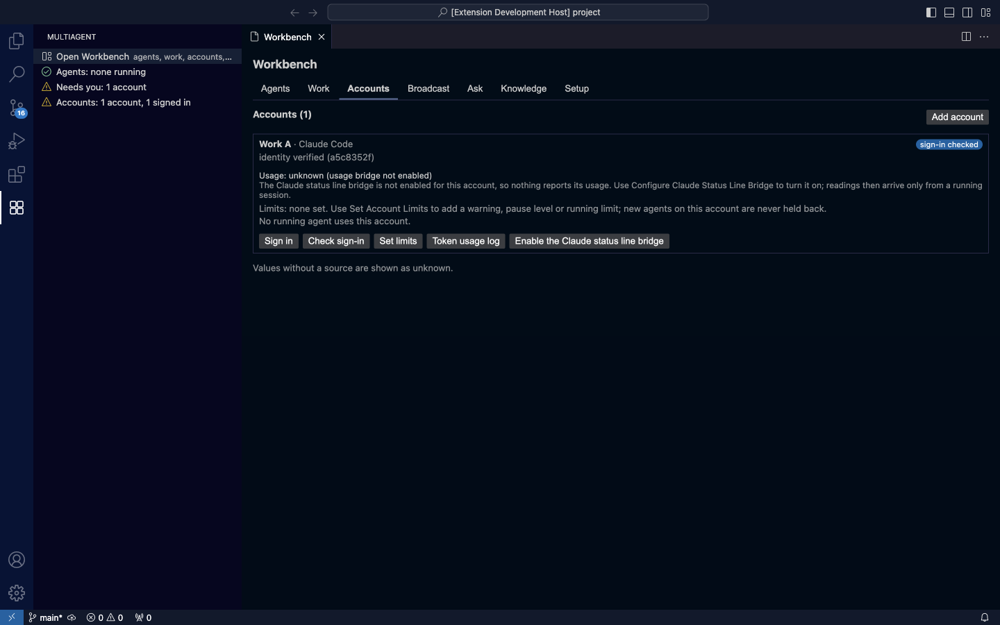
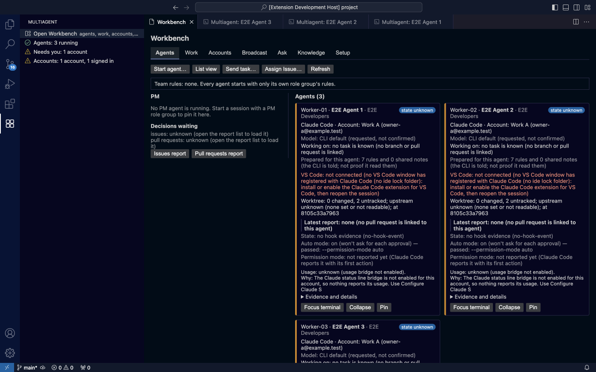

# Multiagent 使用教學

這份教學依管理者驗收清單（#360）的 11 項分章。每一章說明要做什麼、從哪裡點、會看到什麼，以及常見的問題與原因。

**截圖來源**：截圖由端到端測試 `npm run test:e2e -- --update-guide` 自動產生，存放在 `docs/user-guide/images/`。畫面改了，就重新執行這個指令，不要手動更新截圖。測試只使用合成的 CLI 與資料，所以截圖裡沒有真實的帳號。

**目前狀態**：還在開發中的有帳號流程（#352）、GitHub 樣式的頁面（#353）等功能。只有已經做好、而且 e2e 測試走過的部分，才會附上步驟與截圖。還沒做好的項目會寫明，並附上負責的 issue。

## 5 分鐘入門

1. **打開側欄**：點左側活動列的 **Multiagent** 圖示（四個方塊）。側欄只有一個區塊：最上面是 **Open Workbench**，下面三行分別是 agent、需要你處理的事、帳號。點任何一行，都會打開工作台的對應分頁。

   

2. **打開工作台**：點 **Open Workbench**。工作台開在編輯區，有 7 個分頁：Agents、Work、Accounts、Broadcast、Ask、Knowledge、Setup。

   

3. **新增帳號**：在 **Accounts** 分頁按 **Add account**：
   - 選 Claude Code。
   - 輸入名稱。
   - 選「Create a recommended folder」。

   接著按帳號列上的 **Check sign-in**。如果這個帳號還沒登入，就按 **Sign in**，在開啟的終端機裡登入。

   

4. **建立身份組**：在 **Agents** 分頁按 **Create role group…**：
   - 選範本，例如 Developer。
   - 選 Claude Code。
   - 輸入名稱。
   - 按 **Create Role Group**。

5. **啟動 agent**：在 **Agents** 分頁按 **Start agent…**：
   - 選 Claude Code、帳號與身份組。
   - 模型選「Use CLI default model」。
   - 依畫面確認。同一份指示只會問一次。

   每個 agent 都會在編輯區開一個終端機，工作台上也會多一張卡片（見第 11 章）。

## 1. 多帳號登入
尚未完成，見 #352。

## 2. 每個帳號的額度與訂閱
尚未完成，見 #352。帳號列已經會顯示 email（只存在本機記憶體）、方案、登入狀態與 5h／7d 額度（#356），e2e 步驟與截圖之後補上。

## 3. 每個 agent 用哪個帳號
尚未完成，見 #352。

## 4. 和 PM agent 一起 review reports
尚未完成，見 #353。

## 5. 直接問問題
尚未完成，見 #353、#357（Ask 分頁）。

## 6. 直接在 VS Code 上工作
從擴充套件啟動的 Claude Code agent，現在會連到這個 VS Code 視窗（#354）。agent 卡片上會顯示 `VS Code: connected through this window's Claude Code port (…)`。連不上時，會顯示原因與下一步。e2e 步驟與截圖之後補上。

**常見問題**：卡片顯示 `VS Code: not connected (no VS Code window has registered with Claude Code …)`。
- 原因：VS Code 的 Claude Code 擴充套件沒有安裝或沒有啟用。
- 處理方式：安裝或啟用它，然後重新開啟這個 session。

## 7. 對同一個身份組廣播 prompt
尚未完成，見 #357（Broadcast 分頁）。

## 8. PR 與 Issue 像 GitHub 一樣呈現
尚未完成，見 #353。

## 9. 危險自動模式與模型切換
尚未完成，見 #358。

## 10. 用 skills 與共享記憶省 tokens
尚未完成，見 #359。

## 11. 一個畫面看到所有 agent

**要做什麼**：在一個畫面看到所有正在這個專案工作的 agent。

**從哪裡點**：
- 側欄的 **Open Workbench**，或側欄的 **Agents: … running** 那一行，都會打開工作台的 **Agents** 分頁。
- 也可以從 Command Palette 執行 `Multiagent: Open Workbench`。

**會看到什麼**：
- **Agents (數量)**：每個 agent 一張卡片。卡片上有：
  - 代號（例如 Worker-01）、名稱與身份組。
  - CLI 與帳號，例如 `Account: Work A (owner-a@example.test)`。email 是這個視窗最近一次登入檢查讀到的，只存在記憶體裡。
  - 模型。
  - 是否連上 VS Code。
  - 工作資料夾、最近的報告。
  - 模式，例如 `Auto mode: on`。
  - 實際的權限模式、額度。
- 左邊是 PM 與待決定的事項。

下圖是 e2e 用合成的 CLI 啟動 3 個 agent 之後的畫面：

**常見問題**：
- **卡片寫 `VS Code: not connected (…)`**：這個視窗裡沒有 VS Code 的 Claude Code 擴充套件（見第 6 章）。
- **卡片寫 `state unknown`**：agent 還沒回報狀態，畫面不會猜測。
- **側欄寫 `Needs you: 1 account`**：打開 Accounts 分頁，看那個帳號寫了什麼，例如額度橋接還沒設定。

## 限制

e2e 測試證明的是「畫面與流程」。以下項目仍需要管理者在實機確認（#135）：
- 真實帳號的登入。
- 真實的 CLI 是否照指示執行。
- 原生 Windows 上的行為。
