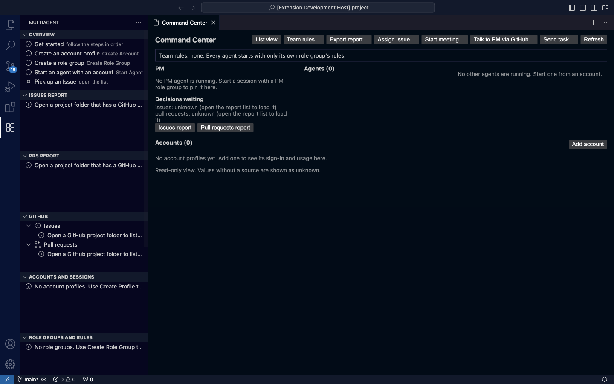

# Multiagent 使用教學

這份教學依管理者驗收清單（#360）的 11 項分章。每一章說明要做什麼、從哪裡點、會看到什麼，以及常見的問題與原因。

**截圖來源**：截圖由端到端測試 `npm run test:e2e -- --update-guide` 自動產生，存放在 `docs/user-guide/images/`。畫面改了，就重新執行這個指令，不要手動更新截圖。測試只使用合成的 CLI 與資料，所以截圖裡沒有真實的帳號。

**目前狀態**：工作台（#357）、帳號流程（#352）等功能還在開發中。只有已經做好、而且 e2e 測試走過的部分，才會附上步驟與截圖。還沒做好的項目會寫明，並附上負責的 issue。

## 5 分鐘入門

1. **打開側欄**：點左側活動列的 **Multiagent** 圖示（四個方塊）。側欄目前有 9 個區塊。這是**尚未完成**的狀態：#357 會精簡成只有一個入口。

   

2. **建立帳號**：在 **Accounts and Sessions** 按 **Create Account**，替 Claude Code 或 Codex 建立一個帳號資料夾，然後依畫面指示登入。
3. **建立身份組**：在 **Role Groups and Rules** 按 **Create Role Group**。身份組決定 agent 可以做什麼，例如 PM、worker。
4. **啟動第一個 agent**：在 Overview 按 **Start Agent**，選帳號與身份組。agent 會在編輯區的終端機裡執行。
5. **在一個畫面看所有 agent**：按 **Open Command Center**，或從 Command Palette 執行 `Multiagent: Open Command Center`（見第 11 章）。

> 第 2～4 步的截圖，會在對應的 PR（#352、#357）把 e2e 步驟補上之後產生。

## 1. 多帳號登入
尚未完成，見 #352。

## 2. 每個帳號的額度與訂閱
尚未完成，見 #352。帳號列已經會顯示 email（只存在本機記憶體）、方案、登入狀態與 5h／7d 額度（#356），e2e 步驟與截圖之後補上。

## 3. 每個 agent 用哪個帳號
尚未完成，見 #352。

## 4. 和 PM agent 一起 review reports
尚未完成，見 #353。

## 5. 直接問問題
尚未完成，見 #353、#357（Ask 分頁）。

## 6. 直接在 VS Code 上工作
從擴充套件啟動的 Claude Code agent，現在會連到這個 VS Code 視窗（#354）。agent 卡片上會顯示 `VS Code: connected through this window's Claude Code port (…)`。連不上時，會顯示原因與下一步。e2e 步驟與截圖之後補上。

**常見問題**：卡片顯示 `VS Code: not connected (no VS Code window has registered with Claude Code …)`。
- 原因：VS Code 的 Claude Code 擴充套件沒有安裝或沒有啟用。
- 處理方式：安裝或啟用它，然後重新開啟這個 session。

## 7. 對同一個身份組廣播 prompt
尚未完成，見 #357（Broadcast 分頁）。

## 8. PR 與 Issue 像 GitHub 一樣呈現
尚未完成，見 #353。

## 9. 危險自動模式與模型切換
尚未完成，見 #358。

## 10. 用 skills 與共享記憶省 tokens
尚未完成，見 #359。

## 11. 一個畫面看到所有 agent

> **尚未驗收**（#357）：目前只能打開指揮台並看到它的畫面。#360 的驗收條件還沒做：啟動至少 3 個 agent，畫面上要出現 3 張卡片，並且看得到代號、帳號與模式。這部分會由 #357 的 Agents 分頁完成。

**要做什麼**：在一個畫面看到所有正在這個專案工作的 agent，以及帳號、待決定的事項。

**從哪裡點**：
- 開啟 Command Palette（macOS 按 ⌘⇧P，Windows 按 Ctrl+Shift+P），輸入 `Multiagent: Open Command Center`，按 Enter。
- 或在側欄的 Overview 按 **Open Command Center**。

**會看到什麼**：編輯區會開啟 **Command Center** 分頁，包括：
- 上方：團隊規則摘要。
- 左邊：PM 與待決定的事項。
- 右邊：**Agents (數量)**，每個 agent 一張卡片。
- 下方：**Accounts (數量)**。

**常見問題**：
- **啟動了 agent 卻看不到卡片**：#368 修正前，在比較忙碌的機器上，畫面可能一直停在舊資料。修正後，卡片會先出現，比較慢的資料到了再補上。
- **卡片寫 `unknown`**：代表沒有可靠的來源，例如 agent 還沒回報狀態。這不是錯誤，畫面不會猜測。

## 限制

e2e 測試證明的是「畫面與流程」。以下項目仍需要管理者在實機確認（#135）：
- 真實帳號的登入。
- 真實的 CLI 是否照指示執行。
- 原生 Windows 上的行為。
